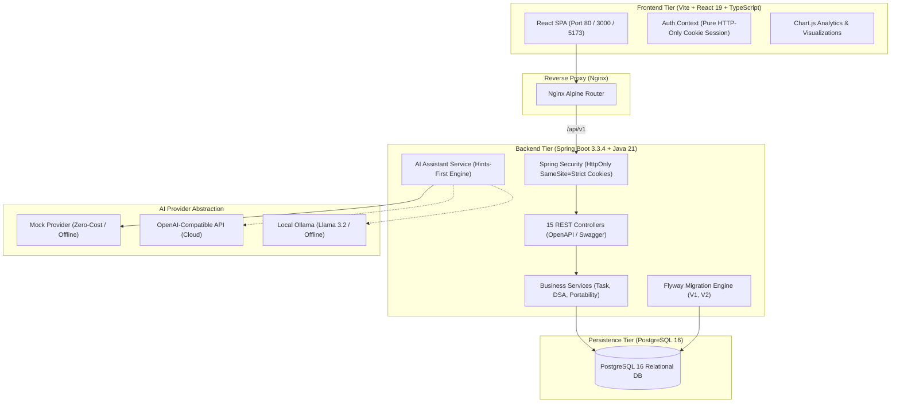

# 📚 StudyTracker — Secure AI Product Engineer Career Platform

A full-stack, database-backed personal engineering platform designed to drive **Jayasuriya's 52-week transition plan (2 November 2026 – 31 October 2027)**:
> **TCS Software Engineer (WCAS Java & Flutter defect resolution)** ➔ **AI-Augmented Secure Product Engineer**  
> **Career Target:** Product Company Software Engineering / Full-Stack Roles with a long-term specialization in Application Security and DevSecOps.  
> **Weekly Schedule:** 14 hours/week standard capacity (12–15h range).  
> **DSA Target:** 120–160 well-understood problems with pattern and complexity retention.  
> **Compensation Ambition:** ₹30–40 LPA (clearly tracked as an ambition rather than a guaranteed outcome).

---

## 🏗️ System Architecture

StudyTracker is built as a cloud-native, decoupled multi-tier architecture with clean ownership boundaries, database-enforced user isolation, and an educational AI provider abstraction.



---

## 🔒 Authentication & Security Architecture

1. **Pure HTTP-Only Cookie Authentication**:
   - Authentication tokens are **never stored in `localStorage`**.
   - On `/api/v1/auth/login` or `/api/v1/auth/register`, Spring Boot sets an HTTP-only `ResponseCookie`:
     - `HttpOnly = true` (inaccessible to JavaScript, immune to XSS token theft)
     - `SameSite = Strict` (defense against CSRF attacks)
     - `Secure = true` in production (transmitted exclusively over HTTPS)
     - `Path = /`
   - Frontend `fetch` requests include `credentials: 'include'`.
   - On `/api/v1/auth/logout`, the server expires the cookie with `maxAge = 0`.
2. **Demo Account Hardening**:
   - Demo-account auto-initialization is **disabled by default** (`DEMO_ACCOUNT_ENABLED=false`).
   - Insecure hardcoded passwords (e.g. `password123`) have been eliminated.
   - For local development, demo account creation can be enabled by setting `DEMO_ACCOUNT_ENABLED=true` and supplying a custom password via `DEMO_ACCOUNT_PASSWORD`.
   - Passwords are never logged.
3. **Strict User Ownership Isolation**:
   - Queries enforce ownership at the service layer by `ownerId`.
   - Modifying or deleting another user's resources results in an immediate `404 Not Found`.

---

## ⚡ Running with Docker Compose

The complete full-stack stack (PostgreSQL, Spring Boot backend, and React/Nginx frontend) is configured for containerized execution:

```bash
docker compose up --build
```

- **Web Application:** [http://localhost](http://localhost) or [http://localhost:3000](http://localhost:3000)
- **Backend API & Swagger UI:** [http://localhost:8080/swagger-ui.html](http://localhost:8080/swagger-ui.html)
- **Actuator Health Check:** [http://localhost:8080/actuator/health](http://localhost:8080/actuator/health)

> [!NOTE]
> *Environment Status:* Docker configuration was created, but runtime verification was not performed because Docker is unavailable in this environment. The Docker compose configuration and builds are automated and verified via GitHub Actions CI.

---

## 💻 Non-Docker Local Development Setup

### 1. Prerequisites
- **Java 21 JDK** (Eclipse Temurin or OpenJDK 21)
- **Node.js 20+** and **npm 10+**
- **PostgreSQL 15+** running locally (or test environment)

### 2. Backend Setup (Spring Boot 3.3.4 + Java 21)
```bash
cd backend

# On Windows:
.\mvnw.cmd clean test
.\mvnw.cmd spring-boot:run

# On Linux/macOS:
./mvnw clean test
./mvnw spring-boot:run
```
*Backend runs on `http://localhost:8080`.*

### 3. Frontend Setup (React 19 + TypeScript + Vite)
```bash
cd frontend
npm ci
npm run lint
npm test -- --run
npm run build
npm run dev
```
*Frontend runs on `http://localhost:5173`. Requests to `/api/` are automatically proxied to `http://localhost:8080`.*

---

## 🌟 Modules & Working REST Controllers

| Module | Controller | Base Path | Endpoints |
|---|---|---|---|
| **Authentication** | `AuthController` | `/api/v1/auth` | `/register`, `/login`, `/logout`, `/me`, `/profile` |
| **Curriculum** | `RoadmapController` | `/api/v1` | `/roadmap`, `/weeks`, `/weeks/{weekNumber}` |
| **Tasks** | `TaskController` | `/api/v1/tasks` | `POST /`, `PUT /{id}`, `PATCH /{id}/toggle`, `DELETE /{id}`, `POST /{id}/carry-forward` |
| **Study Sessions** | `StudySessionController` | `/api/v1/sessions` | `POST /`, `GET /`, `GET /stats` |
| **DSA Tracker** | `DsaController` | `/api/v1/dsa` | `POST /`, `PUT /{id}`, `DELETE /{id}`, `GET /`, `GET /stats`, `GET /revision-queue` |
| **Weekly Reviews** | `WeeklyReviewController` | `/api/v1/reviews` | `GET /{weekId}`, `POST /` |
| **Projects** | `ProjectController` | `/api/v1/projects` | `GET /`, `POST /`, `PUT /{id}`, `POST /{id}/milestones`, `PATCH /milestones/{id}/toggle` |
| **Career Pipeline** | `CareerController` | `/api/v1/career` | `GET /applications`, `POST /applications`, `PUT /applications/{id}`, `DELETE /applications/{id}`, `GET /interviews`, `POST /interviews` |
| **Dashboard** | `DashboardController` | `/api/v1/dashboard` | `GET /` (metrics, countdown, focus) |
| **Analytics** | `AnalyticsController` | `/api/v1/analytics` | `GET /` (velocity charts, hours by category, funnel) |
| **Search** | `SearchController` | `/api/v1/search` | `GET /?q={keyword}` (PostgreSQL unified search) |
| **Portability** | `DataPortabilityController` | `/api/v1/portability` | `/export/json`, `/import/json`, `/export/sessions/csv`, `/export/dsa/csv` |
| **AI Coach** | `AiController` | `/api/v1/ai` | `/status`, `/chat`, `/messages/{id}/rate` |
| **Resources** | `LearningResourceController` | `/api/v1/resources` | `GET /`, `POST /` |
| **Notifications** | `NotificationController` | `/api/v1/notifications` | `GET /`, `PATCH /{id}/read` |

---

## 🤖 Educational AI Assistant Guardrails

- **Hints-First Pedagogy**: Socratic hints that guide learning without spoon-feeding answers.
- **Dedicated Modes**: `HINTS_FIRST`, `QUIZ`, `MOCK_INTERVIEW`, `EXPLAIN`.
- **Mandatory Output Notice**: Visible notice on every response warning of potential hallucinations.
- **Independent Verification Rating**: Grade responses as *Verified Correct*, *Partially Correct*, or *Bug/Hallucination*.
- **Provider Agnostic**: Supports `MOCK` (zero-cost offline), `OPENAI`, or `OLLAMA`.
- *Note: Vector embeddings (pgvector) and document RAG chunking are architected for future phase expansion; the current assistant operates via provider abstraction and context injection.*

---

## 🧪 Automated Testing

### Backend (JUnit 5 + Testcontainers)
```bash
cd backend
./mvnw clean test
```
Tests:
- `RoadmapTimelineCalculatorTests` (5 edge cases: before start, exact start, mid-roadmap, exact end, after end).
- `RoadmapSeedDataValidationTests` (Validates 7 phases, 52 unique weeks, Nov 2 2026 – Oct 31 2027, seed tasks).
- `AuthAndIsolationApiTests` (Validates strict user data isolation).
- `RoadmapCalculationTests` (Phase completion formulas).
- `TaskServiceTests` (Task toggle and carry-forward).
- `AiAssistantTests` (Rate limits and prompt injection sanitization).
- `PostgreSqlIntegrationTests` (`@Testcontainers(disabledWithoutDocker = true)` for real PostgreSQL integration).

### Frontend (Vitest + Oxlint)
```bash
cd frontend
npm run lint          # Oxlint static analysis
npm test -- --run     # Vitest unit tests
npm run build         # Vite production build
```

---

## 📄 License
MIT License. Created for Jayasuriya's career preparation journey (2026–2027).
