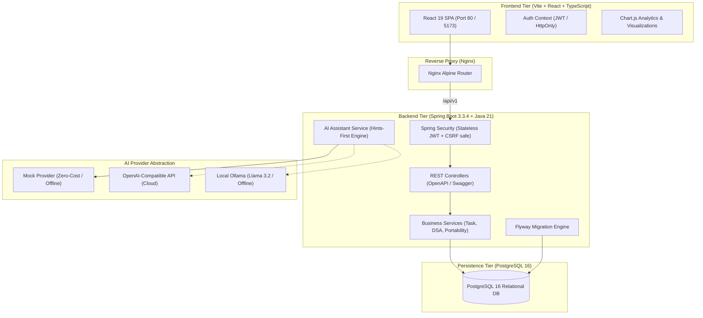

# 📚 StudyTracker — Secure AI Product Engineer Career Platform

A full-stack, database-backed personal engineering platform designed to drive **Jayasuriya's 52-week transition plan (2 November 2026 – 31 October 2027)**:
> **TCS Software Engineer (WCAS Java & Flutter defect resolution)** ➔ **AI-Augmented Secure Product Engineer**  
> **Career Target:** Product Company Software Engineering / Full-Stack Roles with a long-term specialization in Application Security and DevSecOps.  
> **Weekly Schedule:** 14 hours/week standard capacity (12–15h range).  
> **DSA Target:** 120–160 well-understood problems with pattern and complexity retention.  
> **Compensation Ambition:** ₹30–40 LPA (clearly tracked as an ambition rather than a guaranteed outcome).

---

## 🏗️ System Architecture

StudyTracker is built as a cloud-native, decoupled multi-tier architecture with clean ownership boundaries, database-enforced user isolation, and an educational AI provider abstraction.



---

## ⚡ Quick Start: Run with Docker Compose (Recommended)

The entire full-stack application (PostgreSQL, Spring Boot backend, and React/Nginx frontend) starts with **a single command**:

```bash
docker compose up --build
```

Once running:
- **Web Application:** [http://localhost](http://localhost) (or [http://localhost:3000](http://localhost:3000))
- **Backend API & Swagger UI:** [http://localhost:8080/swagger-ui.html](http://localhost:8080/swagger-ui.html)
- **Actuator Health Check:** [http://localhost:8080/actuator/health](http://localhost:8080/actuator/health)

### Demo Account (Pre-Seeded)
The application automatically seeds a demo account on first run:
- **Username:** `jayasuriya`
- **Password:** `password123`
- *Note: You can also click the "Fill Demo Credentials" button on the login screen or register an entirely new account.*

---

## 💻 Non-Docker Local Development Setup

If you wish to develop frontend and backend separately without Docker:

### 1. Prerequisites
- **Java 21 JDK** (Temurin or OpenJDK 21)
- **Node.js 20+** and **npm 10+**
- **PostgreSQL 15+** running locally (or H2 in-memory for testing)

### 2. Backend Setup
1. Configure environment variables in `.env` (or pass via terminal):
   ```bash
   cd backend
   ```
2. Build and run tests:
   ```bash
   ./mvnw clean test
   ```
3. Start the Spring Boot server:
   ```bash
   ./mvnw spring-boot:run
   ```
   *The backend starts at `http://localhost:8080` and connects to PostgreSQL (falling back to H2 for automated tests).*

### 3. Frontend Setup
1. Navigate to `frontend/`:
   ```bash
   cd frontend
   npm install
   ```
2. Start the Vite development server with proxy:
   ```bash
   npm run dev
   ```
   *Access the frontend at `http://localhost:5173`. Requests to `/api/` are automatically proxied to `http://localhost:8080`.*

---

## 🌟 Core Features & Modules

### 1. 52-Week Transition Curriculum (Nov 2026 – Oct 2027)
- **7 Phased Milestones (Phase A through G)**:
  - **Phase A (Weeks 1–8):** Core Engineering Foundations, Concurrency, Git, & AI-Assisted Fluency.
  - **Phase B (Weeks 9–16):** Java 21 Deep Dive, Spring Boot Architecture, SQL Optimization, & Redis.
  - **Phase C (Weeks 17–24):** Enterprise Microservices, Secure REST APIs, & Synthetic Banking Defect Resolution.
  - **Phase D (Weeks 25–32):** Flagship AI Credit Copilot (Spring AI, RAG, pgvector, Keycloak OAuth2).
  - **Phase E (Weeks 33–40):** Application Security, OWASP Top 10, DevSecOps CI/CD Pipelines, & Threat Modeling.
  - **Phase F (Weeks 41–48):** Product-Company Applications, High-Level System Design, & Mock Interviews.
  - **Phase G (Weeks 49–52):** Offer Negotiations, Comp Benchmarking (₹30–40 LPA), & Transition Finalization.
- **260 Granular Seeded Tasks**: Check off deliverables, add custom tasks, and carry forward unfinished tasks between weeks.
- **Pre-Start Countdown**: Live countdown until the 2 November 2026 kick-off.

### 2. Deep Work Study Timer & Ledger
- Live stopwatch widget with task association and distraction notes.
- Offline session logger for manual entry.
- Historical ledger measuring consistency toward the 14h/week target.

### 3. DSA Problem Tracker (Target: 120–160 Problems)
- Categorized by algorithmic pattern (Two Pointers, Sliding Window, Trees, Graphs, DP, Intervals).
- Spaced-repetition revision queue to revisit challenging problems.
- Time & space complexity logging with confidence scores.

### 4. Weekly Reflection & Verification Journal
- Structured around the 4 core prompts:
  1. *What was studied and built?*
  2. *What did AI get right?*
  3. *What did AI get wrong? (Hallucinations, bugs, antipatterns)*
  4. *What was verified independently through tests and documentation?*
- Draft and Finalized modes with hours auto-calculation.

### 5. Synthetic Portfolio Projects (Zero Confidential Data)
- **Flagship Project:** *Secure Enterprise Credit Copilot* (Spring Boot, Spring AI, pgvector, Keycloak, synthetic corporate loan evaluations).
- **Secondary Project 1:** *Flutter DevSecOps Defect Telemetry* (OWASP Mobile Top 10, SonarQube, defect triage).
- **Secondary Project 2:** *Cloud-Native API Security Gateway* (Rate limiting, Vault secret management, JWT validation).
- *Strict adherence to confidentiality: Zero TCS, Commercial Bank of Dubai, or WCAS proprietary data.*

### 6. Career Application Pipeline & Mock Interviews
- Compensation ambition tracker: ₹30–40 LPA breakdown (Base, Bonus, ESOPs).
- Kanban pipeline: Wishlist ➔ Applied ➔ Screening ➔ Tech Round ➔ System Design ➔ Offer.
- Mock interview logger with evaluation ratings (1–10) and feedback.

### 7. Performance & Velocity Analytics (Chart.js)
- Weekly effort velocity vs 14h target.
- Time distribution across engineering pillars (DSA, Java, AI, AppSec).
- Phase completion percentages and DSA pattern coverage.

### 8. Educational AI Study Coach
- **Hints-First Mode:** Socratic hints that teach problem-solving without giving away raw solutions.
- **Quiz & Mock Interview Modes:** Tests conceptual understanding and system design trade-offs.
- **Mandatory Verification Advisory:** Clear notices on every response reminding that AI can hallucinate.
- **Output Rating:** Grade AI responses as *Verified Correct*, *Partially Correct*, or *Bug/Hallucination*.
- **Provider Agnostic:** Supports `MOCK` (built-in offline provider), `OPENAI` (cloud API), or `OLLAMA` (local LLM).

### 9. Complete Data Portability
- 1-click JSON backup export and restore.
- CSV exports for study sessions and DSA records.

---

## 🔒 Security & Privacy

- **User Data Isolation:** Queries explicitly filter by `userId` to prevent IDOR vulnerabilities.
- **Password Hashing:** BCrypt with strong salt rounds.
- **Authentication:** Stateless JWT with support for `HttpOnly`, `SameSite=Strict` cookies.
- **Prompt Injection Defense:** Input sanitation filtering adversarial override tokens.
- For more details, consult [SECURITY.md](SECURITY.md).

---

## 📂 Repository Structure

```
├── backend/                   # Spring Boot 3.3.4 (Java 21) REST Backend
│   ├── src/main/java/         # Controllers, Services, Repositories, Entities
│   ├── src/main/resources/    # Flyway Migrations (V1, V2), configs
│   ├── Dockerfile             # Multi-stage Eclipse Temurin build
│   └── pom.xml
├── frontend/                  # React + TypeScript + Vite SPA
│   ├── src/components/        # Reusable UI components & Timer Widget
│   ├── src/pages/             # 12 modular application pages
│   ├── src/services/          # Typed API client
│   ├── Dockerfile             # Multi-stage Node + Nginx Alpine build
│   └── nginx.conf             # SPA routing & API reverse proxy
├── legacy-static/             # Archived original static HTML/JS files
├── docker-compose.yml         # Containerized production stack
├── .env.example               # Safe configuration template
├── SECURITY.md                # Security policy & threat model
└── README.md                  # Project documentation
```

---

## 🧪 Automated Testing

### Backend Unit & Integration Tests
```bash
cd backend
./mvnw clean test
```
Validates:
- User authentication and data isolation.
- Phase completion and percentage calculations.
- AI assistant prompts and prompt injection sanitization.
- Task status toggles and milestone tracking.

### Frontend Typechecking & Build
```bash
cd frontend
npm run build
```

---

## 📄 License
MIT License. Created for Jayasuriya's career preparation journey (2026–2027).
